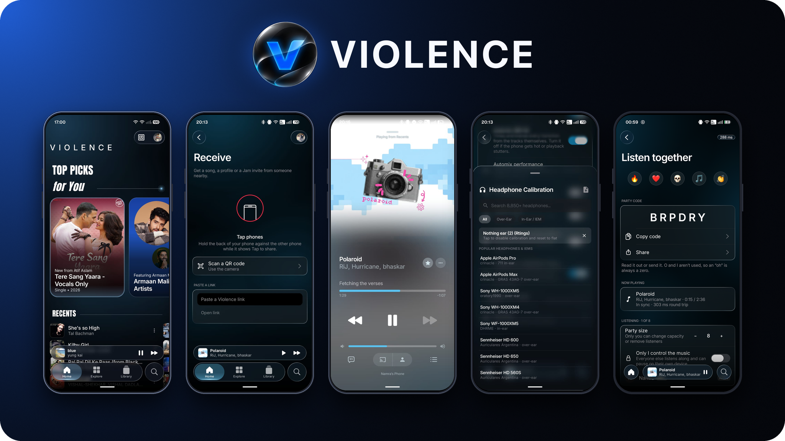

 
 

# Violence

### Private Music Streaming Client

 

[**About This Fork**](#about-this-fork) · [**Features**](#features) · [**Disclaimer**](#disclaimer) · [**License**](#license)

## About this fork

**Violence Music** is a fork of [BitChord](https://github.com/kushagrasinghx/BitChord), created by Kushagra Singh. It builds on BitChord's open-source foundation with its own changes and features.

- **License:** The original BitChord project is licensed under the GNU General Public License v3.0 (GPL-3.0), and this fork stays licensed under the GNU General Public License v3.0 (GPL-3.0).
- **Modifications:** This project has been modified from the original starting on October 30, 2026.
- **Credit:** BitChord and its design are the work of Kushagra Singh; this fork is maintained separately and is not endorsed by YouTube, Google, Spotify, Last.fm, or Apple.

### Main Changes
Based on fork documentation and logs (`/fork-docs`):
- **Rebrand:** Renamed application identity and user-facing assets to Violence across Android, TV, Web, and companion extensions; updated package application IDs, URI schemes (`violence://`), and notification channels.
- **Author-Hosted Services Disabled or Replaced:** Decoupled and disabled upstream author telemetry and presence pings (`api.bitchord.kushagrasingh.in/api/presence`), upstream update check polling, and donation/promotional links.
- **New CI:** Configured automated GitHub Actions workflows for Android phone/TV debug builds and GitHub Pages web deployment with SPA routing.
- **Playback Sources & APIs Reference:** See [fork-docs/PLAYBACK_SOURCES.md](fork-docs/PLAYBACK_SOURCES.md) for complete technical documentation of playback endpoints, login flows, lyrics providers, and replacement guides.

### Third-Party Disclaimer
Violence is not affiliated with or endorsed by YouTube, Google, Spotify, Last.fm, or Apple. All trademarks, service marks, trade names, and logos belong to their respective owners. Users are solely responsible for complying with the terms of service of any third-party platforms they access through this software. The user interface of Violence is inspired by Apple Music.

---

<h1>Features</h1>

<table>
  <tr>
    <td width="50%" valign="top">

#### Playback
- **Search, browse and play** anything available on YouTube Music.
- **Hi-Res lossless audio** — FLAC/ALAC from a configured module source, with YouTube Music as fallback.
- **Gapless playback with true crossfade**, adjustable 0–12s.
- **Automix [Beta]** — DJ-style transitions with beat-matching and tempo-stretching.
- **Offline downloads** — save tracks with embedded metadata.
- **Local music library** integration.
- **Background playback** via a proper foreground media session.
- **Apple-like lyrics animation** — credit to [binimum](https://github.com/binimum/am-lyrics).

#### Connectivity & Accounts
- **Sign in with your Google account** for personalized content.
- **Spotify integration** — connect your account to play your playlists and Liked Songs.
- **Discord Rich Presence** — in-app login, live track/artist/album and progress.
- **Scrobbling** to Last.fm and ListenBrainz.
- **Pluggable sources** — add, edit, test and health-check module sources.
- **Jam (Listen Together)** — sync listening with up to 15 members, wake-up notice, profile identities, and link sharing across Android, TV, Web, and Desktop.
- **In-app profiles & friends** — 24 avatars, custom accent color, local friends list, and link sharing without requiring a Google sign-in.
- **Universal link sharing** — `violence://` scheme handler, QR codes, and clipboard link sharing for songs, playlists, profiles, and Jam.

    </td>
    <td width="50%" valign="top">

#### Experience
- **Animated album canvas** — motion artwork on the now-playing screen.
- **Word-synced lyrics** — word/syllable-level highlighting from multiple sources.
- **Lyrics providers** — credit to [lrc.red](https://lrc.red), [BiniLyrics](https://github.com/binimum), [BetterLyrics](https://github.com/better-lyrics/better-lyrics), [PaxSenix](https://lyrics.paxsenix.org), [LyricsPlus](https://github.com/ibratabian17/YouLyPlus), [SimpMusic](https://github.com/maxrave-dev/SimpMusic), [Unison](https://unison.boidu.dev), [Megalobiz](https://www.megalobiz.com), [KuGou](https://www.kugou.com), [LRCLIB](https://lrclib.net), [Musixmatch](https://www.musixmatch.com) and [Genius](https://genius.com).
- **Dynamic, artwork-driven theming** — Material palette extracted from album art.
- **Frosted-glass UI** — translucent bars via Haze, Material 3 theming.

#### Controls & Tweaks
- **Per-network audio quality** — separate quality ceilings for Wi-Fi and mobile data.
- **Playback speed control** (0.5×–2.0×) and **skip silence**.
- **Sleep timer** — fixed presets or "stop after this track".
- **System equalizer** integration.
- **Bit-perfect USB exclusive output** — sends lossless tracks to a USB DAC unchanged, at each track's own rate and bit depth. Thanks to [Mornye](https://github.com/mornyeapp/Mornye) for the reference.
- **Stats for nerds** — codec, bit depth, sample rate, and more on the now-playing screen.
- **Desktop system tray & shortcuts** — minimize-to-tray, playback popup, global hotkeys (Space, Ctrl+F, Arrow keys, Esc), and media key integration (Windows SMTC, Linux MPRIS).
- **Installable Web PWA** — standalone mode, maskable icons, dynamic theme-color and accent-tinted SVG favicons.

    </td>
  </tr>
</table>

---

<h1>Disclaimer & Legal Notice</h1>

Violence is an independent, private third-party audio player and client. It is **not** associated with Google LLC, YouTube Music, Deezer, Telegram, or any of their parent companies.

* **No Media Hosting:** Violence does not host, upload, or store copyrighted music files. It operates strictly as an interface to scan local device storage or stream media directly from public, public-facing, or user-authenticated APIs.
* **Fair Use & API Usage:** This software is created solely for personal research, educational, and fair-use purposes. The user is entirely responsible for ensuring their usage aligns with their local copyright laws and YouTube Terms of Service.
* **No Ad-Blocking Guarantee:** While Violence focuses on providing a clean listening environment, it does not guarantee permanent bypasses or modifications to commercial third-party platform conditions.
* **Copyleft:** Violence is free software under the GPLv3. Any distribution must come with the Corresponding Source under the same license.

---

<h1>License</h1>

This project is licensed under the **GNU General Public License v3.0 (GPLv3)**. See the [LICENSE](LICENSE) file for details.

## Violence Style (experimental)

An optional skin for Android phone, Desktop, and Web: a display-serif heading style, a live glowing background, glass bars and buttons, and accent colours taken from the playing song, your device or a colour you pick. It is **off by default**, and with it off the app is exactly the app without it.

- **Turn it on:** Settings > "Advanced & experimental options" on Android, or Settings > "Appearance" on Desktop and Web. On Android it follows your theme (System, Light or Dark) and has a dark and a light look; Desktop and Web use the dark look.
- **Settings:** background (Aurora, Corner, Haze, Off), motion (Off, Subtle, Normal), glow intensity (Low, Medium, High), accent source (Song, Device, Custom with nine presets and a picker), heading font (Bodoni Moda, Cormorant, Anton), reduce transparency, and a glow on album and playlist pages. A "Mode" line shows when the app runs in Lite mode (older Android, low memory, battery saver, reduced blur).
- **If something goes wrong:** switch it off in the same place. If the app fails to start twice in a row with the skin on, it turns itself off and tells you.
- **Report a problem:** say which device and Android version you use and which settings were on.
- Fonts used by the skin (Inter, Bodoni Moda, Cormorant Garamond, Anton) are under the SIL Open Font License 1.1; see `NOTICE`. More: `fork-docs/style/STYLE_OVERVIEW.md`.
