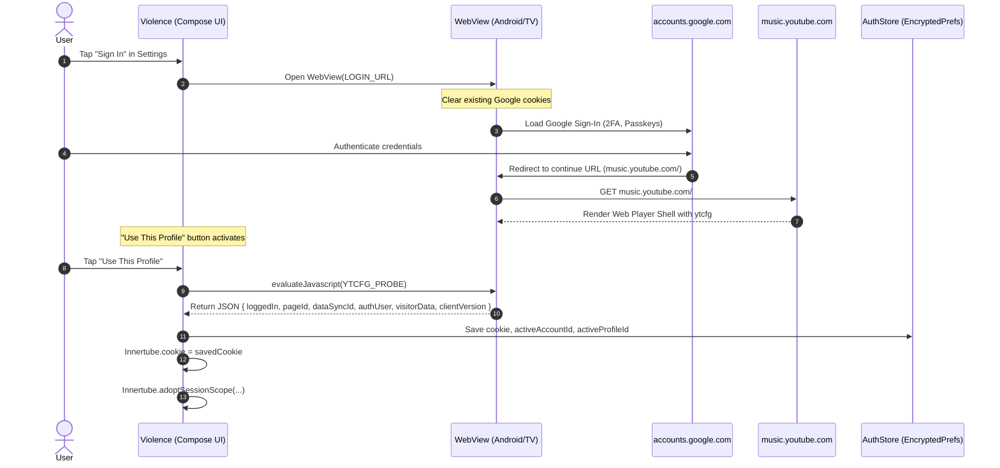
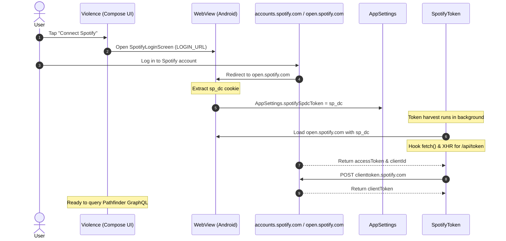
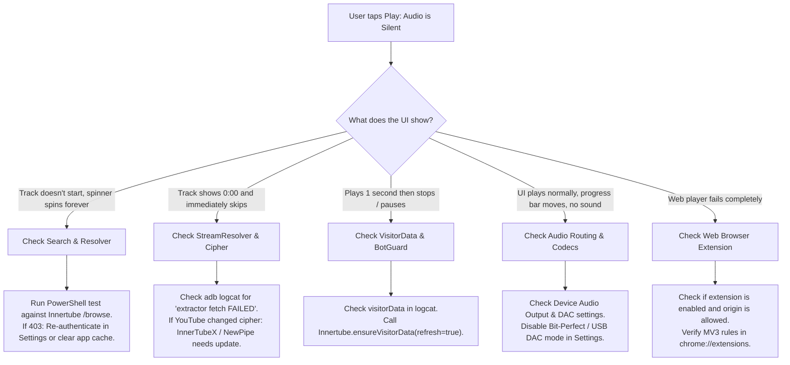

# Playback Sources, APIs, and Login Flows Reference

**Project:** Violence (Private fork of BitChord, GPL-3.0)  
**Application ID:** `com.yashaswahuh.violencemusic` (TV: `.tv`, dev flavors add `.dev`)  
**Deep Link Scheme:** `violence://`  
**Target Audience:** 4–6 core personal users (up to 10–15 including family/close friends).  
**Verification Date:** November 4, 2026. Rate limits, quotas, and third-party behavior verified against official documentation, live network testing, and the repository source code.

---

## 1. Quick-Reference Services Matrix

| Service / API | Role in App | Hosted By | Account / Key Required? | Free Status | Platforms Using It | Health Risk | Reason |
|---|---|---|---|---|---|---|---|
| **YouTube Music (InnerTube)** | Search, browse, album/artist metadata, radio/up-next queue, library | Google LLC | No for guest; User Google session for library | 100% Free | Android, TV, Web (via extension); *Dormant: `desktopApp/src/main/kotlin/com/music/violence/desktop/DesktopApp.kt`* | **Medium** | Google actively updates InnerTube payloads, bot detection, and requires evolving client profiles. |
| **YouTube Video CDN (googlevideo)** | Audio byte delivery (Opus itag 251, AAC itags 140/141) | Google LLC | No (URLs signed with time-limited IP/cipher tokens) | 100% Free | Android, TV, Web (via Shaka Player); *Dormant: `desktopApp/src/main/kotlin/com/music/violence/desktop/DesktopApp.kt`* | **Medium** | URLs expire in ~6 hours; throttled/blocked if IP flagged for scraping or missing visitor token. |
| **InnerTubeX & NewPipeExtractor** | Resolves stream URLs, deciphers signatures, evaluates JS player configs | On-device KMP libraries (`innertubex`, `NewPipeExtractor`) | No | 100% Free (Open-source libraries) | Android, TV; *Dormant: `desktopApp/src/main/kotlin/com/music/violence/desktop/DesktopApp.kt`* | **Medium** | YouTube frequently modifies cipher deobfuscation algorithms (`n-sig`, `player.js`). |
| **YouTube Imagery CDN** | Track covers, album artwork, artist avatars, playlist covers | Google LLC (`i.ytimg.com`, `yt3.ggpht.com`) | No | 100% Free | Android, TV, Web; *Dormant: `desktopApp/.../DesktopArtworkPalette.kt`* | **Low** | Public, highly stable CDN image hosting with no authentication. |
| **YouTube Session Bootstrap (`sw.js_data`)** | Generates `visitorData` tokens to bypass anonymous rate-limits | Google LLC (`www.youtube.com/sw.js_data`) | No | 100% Free | Android, TV, Web; *Dormant: `desktopApp/src/main/kotlin/com/music/violence/desktop/DesktopApp.kt`* | **Medium** | Google may alter the internal array structure of `sw.js_data`. |
| **YouTube Music In-App Login** | Google account sign-in, multi-channel selection, `SAPISIDHASH` minting | User-authenticated directly against Google (`accounts.google.com`) | Yes (User's personal Google credentials) | 100% Free | Android, TV, Web (via extension); *Dormant: `desktopApp/src/main/kotlin/com/music/violence/desktop/DesktopApp.kt`* | **Medium** | Google occasionally modifies Web login forms, bot challenges, or cookie domain policies. |
| **JioSaavn Audio & Catalog** | High-bitrate (320kbps AAC) alternate stream source | JioSaavn / Reliance (`jiosaavn.com`) | No | 100% Free (DES decrypted stream URLs) | Android, TV (Module source); *Dormant: None* | **High** | Reverse-engineered private API using fixed DES key; could change or enforce DRM anytime. |
| **Spotify Pathfinder & Web API** | User library sync (Liked Songs, user playlists import) | Spotify AB (`api-partner.spotify.com`, `spclient.wg.spotify.com`) | Yes (User's `sp_dc` cookie in Settings) | 100% Free (Free Spotify accounts work) | Android, TV; *Dormant: `desktopApp/src/main/kotlin/com/music/violence/desktop/DesktopIntegrationsUi.kt`* | **Medium** | Pathfinder GraphQL operation hashes change with Spotify web player bundle updates. |
| **Spotify Embed Scraper** | Public playlist share link import without Spotify login | Spotify AB (`open.spotify.com/embed/playlist/*`) | No | 100% Free | Android, TV, Web; *Dormant: `desktopApp/src/main/kotlin/com/music/violence/desktop/DesktopIntegrationsUi.kt`* | **Low** | Scrapes Next.js public server data from embed page; resilient to auth changes. |
| **Spotify Canvas Video** | Looping vertical video backgrounds | Spotify AB (`spclient.wg.spotify.com`, `canvaz.scdn.co`) | Yes (Needs valid Spotify access token from `sp_dc`) | 100% Free | Android; *Dormant: None* | **Medium** | Endpoint enforces mobile app User-Agent and client token validation. |
| **Community Canvas (ViviMusic)** | Curated fallback looping video manifest | Community Cloudflare Worker (`vivimusicanvas.mkmdevilmi.workers.dev`) | No | 100% Free | Android; *Dormant: None* | **High** | Single community Cloudflare Worker; if volunteer shuts down worker, source fails. |
| **Apple Music Catalog API** | Motion video artwork (`editorialVideo`), high-res album art | Apple Inc. (`amp-api.music.apple.com`) | Scrapes anonymous guest bearer from web player | 100% Free | Android, TV; *Dormant: None* | **Medium** | Anonymous web token rotation or storefront policy changes can break scraping. |
| **Apple Artist Art (iTunes API)** | Hero artist photos and vector/PNG title logos | Apple Inc. (`itunes.apple.com/search`, `music.apple.com`) | No | 100% Free | Android, TV; *Dormant: None* | **Low** | iTunes Search API is a longstanding public Apple developer endpoint (~20 calls/min). |
| **Tidal Public Embed API** | Square looping album video covers | Aspiro AB / Tidal (`api.tidal.com/v1/search`) | No (Uses embedded public client token) | 100% Free | Android; *Dormant: None* | **Medium** | Embed token (`vNVdglQOjFJJGG2U`) could be rotated or revoked by Tidal. |
| **Artist Signatures API** | Handwritten artist signature logos | User-configured self-hosted server or mirror | No | Free (depends on user host) | Android; *Dormant: None* | **Low** | Optional feature; defaults to unconfigured/disabled until user enters a URL. |
| **LRCLIB** | Line-synced and plain-text lyrics | Community Open Source (`lrclib.net`) | No (Custom `User-Agent` required) | 100% Free | Android, TV, Web; *Dormant: None* | **Low** | Highly reliable, non-profit community API with documented rate limits (~180/min/IP). |
| **BiniLyrics** | Syllable-synced lyrics & ISRC resolution | Community Open Source (`lyrics-api.binimum.org`) | No | 100% Free | Android, TV, Web; *Dormant: None* | **Medium** | Volunteer community mirror; may experience intermittent downtime. |
| **lrc.red** | Apple-style TTML syllable-synced lyrics by ISRC | Community Open Source (`lrc.red`) | No | 100% Free | Android, TV, Web; *Dormant: None* | **Medium** | Small community server; relies on ISRC index coverage. |
| **BetterLyrics & Unison** | Syllable-synced lyrics | Community Open Source (`lyrics-api.boidu.dev`, `unison.boidu.dev`) | No | 100% Free | Android, TV, Web; *Dormant: None* | **Medium** | Personal developer endpoints; subject to hosting availability. |
| **PaxSenix** | Apple Music & Musixmatch proxy for synced lyrics | Community Scraper (`api.paxsenix.org`, `lyrics.paxsenix.org`) | No | 100% Free | Android, TV, Web; *Dormant: None* | **Medium** | Scraper proxy prone to upstream IP bans or domain changes. |
| **Musixmatch** | Commercial lyrics database | Musixmatch S.p.A. (`apic.musixmatch.com/ws/1.1`) | Embedded hardcoded app token | 100% Free | Android, TV, Web; *Dormant: None* | **Medium** | Embedded API token (`f09016176ba43a1cfd1031fbd6b3d26c`) could be blacklisted. |
| **KuGou** | Asian & Chinese language synced lyrics | Tencent / KuGou (`lyrics.kugou.com`) | No | 100% Free | Android, TV, Web; *Dormant: None* | **Low** | Public mobile client endpoint; historically very stable. |
| **SimpMusic Lyrics** | Video-ID keyed synced lyrics | Community Open Source (`api-lyrics.simpmusic.org`) | No | 100% Free | Android, TV, Web; *Dormant: None* | **Medium** | Community-hosted instance; coverage limited to tracks indexed by SimpMusic. |
| **Genius** | Plain-text lyrics & annotations scraper | Genius Media Group (`genius.com`) | No | 100% Free | Android, TV, Web; *Dormant: None* | **Medium** | Web scraping; changes to Genius website HTML or Cloudflare anti-bot blocks scraping. |
| **Megalobiz** | Community LRC lyrics scraper | Megalobiz (`www.megalobiz.com`) | No | 100% Free | Android, TV, Web; *Dormant: None* | **High** | Third-party ad-supported scraper; frequently down or slow. |
| **LyricsPlus** | Syllable-synced lyrics multi-mirror network | Community Mirrors (`prjktla.my.id`, `atomix.one`, etc.) | No | 100% Free | Android, TV, Web; *Dormant: None* | **Medium** | Individual mirrors frequently cycle or hit free Vercel/Cloudflare bandwidth limits. |
| **Google Translate & Input Tools** | Dynamic lyrics translation & transliteration | Google LLC (`translate.googleapis.com`, `inputtools.google.com`) | No | 100% Free | Android, TV; *Dormant: None* | **Low** | Public Google endpoints (`client=gtx`) with high tolerance for low request volumes. |
| **Last.fm & Libre.fm** | Music scrobbling and artist genre tags | CBS Interactive (`ws.audioscrobbler.com`) & GNU (`libre.fm`) | Yes (User API key for Last.fm; none for Libre.fm) | 100% Free | Android; *Dormant: None* | **Low** | Official developer API; personal API keys are free and never expire. |
| **ListenBrainz** | Non-profit music scrobbling | MetaBrainz Foundation (`api.listenbrainz.org`) | Yes (User ListenBrainz token) | 100% Free | Android; *Dormant: None* | **Low** | Official open non-profit API with 1 req/sec limit per token. |
| **Discord Gateway & RPC** | Rich Presence ("Playing ...") on user Discord profile | Discord Inc. (`gateway.discord.gg`) | Yes (User Discord user token in Settings) | 100% Free | Android, Web (via extension); *Dormant: `desktopApp/.../DesktopDiscordRpc.kt`* | **High** | Uses user account token over WebSocket; Discord considers user-token automation a Terms violation. |
| **Web Extension Network Bridge** | Strips/rewrites Origin and CORS headers for web player | On-device browser extension (`web/extension`) | No | 100% Free (Local extension) | Web only | **Low** | Runs entirely inside user's local browser via MV3 `declarativeNetRequest`. |
| **Pluggable Addons & Modules** | Custom external audio catalogues (lossless/FLAC) | User-defined URLs or local QuickJS scripts | Optional per user | Free (User dependent) | Android; *Dormant: None* | **Low** | Self-contained sandbox running QuickJS on device; completely optional. |
| **WebDAV & SMB** | Remote/local personal library streaming | User's own NAS, cloud storage, or LAN server | Yes (User's storage credentials) | Free (User hardware) | Android; *Dormant: None* | **Low** | Standard open network file sharing protocols. |
| **Listen Together (Jam Backend)** | Multi-device playback state synchronization | Owner's self-hosted instance of `/backend` (Render Free) | No (Room code access) | 100% Free | Android, TV, Web; *Dormant: `desktopApp/.../DesktopListenTogether.kt`* | **Low** | Standalone Go service in repo; owner has full control of deployment. |

---

## 2. Detailed Service Specifications & Replacement Manuals

---

### 2.1 YouTube Music (InnerTube API)

#### What It Does & User Features
InnerTube is the core backend for the entire application. It powers catalog search, autocomplete suggestions, artist discographies, album tracklists, curated explore shelves, "Up Next" queues, related radio mixes (`RDAMVM`), user library playlists, and like/bookmark toggles.

#### Exact Endpoints, Base URLs, & Code Mapping
- **Base URLs:**
  - Music: `https://music.youtube.com/youtubei/v1`
  - Main: `https://www.youtube.com/youtubei/v1`
- **Endpoints:**
  - `/browse`: Shelf feeds, albums, artists, playlists (`Innertube.kt:529`)
  - `/search`: Catalog track, album, and artist search (`Innertube.kt:629`)
  - `/next`: Radio mixes and autoplay queues (`Innertube.kt:603`)
  - `/get_transcript`: Captions and synchronized lyrics fallback (`Innertube.kt:623`)
  - `/account/account_menu`: User profile display and avatar (`Innertube.kt:551`)
  - `/account/accounts_list`: Brand accounts and channel list (`Innertube.kt:561`)
- **Code Map:**
  - `shared/src/jvmSharedMain/kotlin/com/music/violence/data/innertube/Innertube.kt`
  - `shared/src/jvmSharedMain/kotlin/com/music/violence/data/innertube/InnertubeParser.kt`
  - `shared/src/jvmSharedMain/kotlin/com/music/violence/data/YtMusicRepository.kt`
  - Web: `web/app/src/playback/youtube/innertube.ts`
  - Dormant: `desktopApp/src/main/kotlin/com/music/violence/desktop/DesktopApp.kt`

#### Authentication & Session Refresh
Anonymous requests use the `WEB_REMIX` client profile (`clientName: "WEB_REMIX"`, client ID `67`). Authenticated requests attach an encrypted cookie stored in `AuthStore` (`EncryptedPrefs`), extracting `SAPISID` and computing a dynamic SHA-1 authorization hash:
$$\text{SAPISIDHASH } = \text{timestamp} + \text{"\_"} + \text{SHA1}(\text{timestamp} + \text{" "} + \text{SAPISID} + \text{" "} + \text{origin})$$
No long-lived refresh token is used; the session persists as long as the Google login cookie is valid in WebView.

#### Known Limits & Health Risk
- **Rate Limits:** Google applies heuristics based on IP address and request concurrency. For typical single-user browsing, limits are practically unreachable (>1,000 requests/hour). If rapid scraping occurs without `visitorData`, Google responds with HTTP 429 or HTTP 403 `LOGIN_REQUIRED`.
- **Health Risk:** **Medium**. Google periodically changes internal JSON payload structures and protobuf field tags.

#### Failure Modes & Confirmation Tests
- **Symptom:** Search returns empty list; Home screen feeds show "Network error"; radio queue fails to load.
- **Quick Test (PowerShell):**
  ```powershell
  Invoke-RestMethod -Uri "https://music.youtube.com/youtubei/v1/browse" -Method Post -ContentType "application/json" -Body '{"context":{"client":{"clientName":"WEB_REMIX","clientVersion":"1.20250101.01.00"}},"browseId":"FEmusic_home"}'
  ```
  *Expected:* HTTP 200 with JSON payload containing `contents`.

#### Free Sufficiency Check
- **4–6 core users:** 100% Sufficient. Each device queries directly from its own cellular/home IP. There is no central proxy server to be rate-limited.
- **15 total users:** 100% Sufficient. Traffic is distributed across each user's unique residential IP address.

#### How to Replace It
1. **Free Alternatives:**
   - **Alternative 1: Invidious API** (`https://api.invidious.io` / community public instances). *Status: VERIFIED*. Free, no key required, provides REST `/api/v1/search` and `/api/v1/playlists`. Downsides: Public instances suffer from occasional IP bans by YouTube.
   - **Alternative 2: Piped API** (`https://pipedapi.kavin.rocks` / community instances). *Status: VERIFIED*. Free, open-source REST endpoint. Downsides: Instances frequently cycle; requires client to dynamically parse instance health list.
2. **Files to Change:**
   - `shared/src/jvmSharedMain/kotlin/com/music/violence/data/innertube/Innertube.kt` (replace `MUSIC_BASE` with Invidious base URL).
   - `shared/src/jvmSharedMain/kotlin/com/music/violence/data/YtMusicRepository.kt` (adapt parser to Invidious JSON schema).
3. **AI Coding Agent Prompt:**
   > "In `shared/src/jvmSharedMain/kotlin/com/music/violence/data/innertube/Innertube.kt`, create an alternative search client implementing `search(query: String)` using a public Invidious instance (e.g., `https://inv.tux.pizza/api/v1/search?q=...&type=music`). Ensure the response is mapped into `com.music.violence.data.model.Song` models. Do not touch player or streaming code."
4. **Testing & Rollback:**
   - Test by running search in app or via unit tests: `.\gradlew.bat :shared:jvmTest`.
   - Rollback: `git checkout HEAD -- shared/src/jvmSharedMain/kotlin/com/music/violence/data/innertube/Innertube.kt`.

---

### 2.2 YouTube Video CDN (`googlevideo.com`) & Stream Resolution

#### What It Does & User Features
Delivers raw audio byte streams directly to ExoPlayer on Android and Shaka Player on Web. Streams Opus audio at 160 kbps (itag 251) and AAC at 128 kbps (itag 140).

#### Exact Endpoints, Base URLs, & Code Mapping
- **Base Domain:** `https://*.googlevideo.com/videoplayback`
- **Parameters:** Includes signed security parameters: `expire`, `ei`, `ip`, `id`, `itag`, `source=youtube`, `requiressl=yes`, `spc`, `signature` / `sig`.
- **Code Map:**
  - `shared/src/jvmSharedMain/kotlin/com/music/violence/data/innertube/StreamResolver.kt`
  - `shared/src/jvmSharedMain/kotlin/com/music/violence/data/innertube/InnerTubeXResolver.kt`
  - `app/src/main/java/com/music/violence/playback/AudioCache.kt`
  - `app/src/main/java/com/music/violence/playback/ChunkedDataSource.kt`
  - Web: `web/app/src/playback/youtube/resolver.ts` & `ShakaPlayerAdapter.ts`
  - Dormant: `desktopApp/src/main/kotlin/com/music/violence/desktop/DesktopApp.kt`

#### Authentication & Session Refresh
Stream URLs are signed by Google with an expiry timestamp (typically 6 hours). They do not require HTTP Basic or Bearer authentication headers when fetched by ExoPlayer, but they require:
- Client IP consistency (the IP that requested the stream URL from InnerTube must match the IP downloading audio bytes).
- A valid `User-Agent` matching the client profile (e.g. `c=VISIONOS` requests must omit `Origin` and `Referer` headers, handled in `rules.ts:68` and `StreamResolver.kt`).

#### Known Limits & Health Risk
- **Rate Limits:** Downloading at extreme speeds without throttling can trigger HTTP 403 Forbidden or TCP resets.
- **Health Risk:** **Medium**. Google constantly rolls out new cipher obfuscations (`s` parameter descrambling, player nonces, and `n` parameter transforms).

#### Failure Modes & Confirmation Tests
- **Symptom:** Song progress bar moves 1 second and stops; player buffers indefinitely; logs output `HttpDataSource$InvalidResponseCodeException: Response code: 403`.
- **Quick Test (Logcat):**
  ```powershell
  adb logcat -s Violence:D StreamResolver:D ExoPlayer:E
  ```
  *Filter for:* `extractor fetch FAILED` or `InvalidResponseCodeException: 403`.

#### Free Sufficiency Check
- **4–6 core users:** 100% Sufficient. Direct playback streams ~1 MB/min per active listener, entirely from Google's edge cache.
- **15 total users:** 100% Sufficient. No shared bandwidth bottlenecks.

#### How to Replace It
1. **Free Alternatives:**
   - **Alternative 1: Self-hosted Piped Video Proxy.** *Status: VERIFIED*. A self-hosted Piped instance extracts stream URLs and can proxy audio chunks. Free on a VPS or home server.
   - **Alternative 2: NewPipeExtractor fallback enhancement.** *Status: VERIFIED*. Already built into `StreamResolver.kt:51`. When InnerTubeX fails, NewPipeExtractor directly parses `youtube.com/watch?v=...` HTML.
2. **Files to Change:**
   - `shared/src/jvmSharedMain/kotlin/com/music/violence/data/innertube/StreamResolver.kt`
3. **AI Coding Agent Prompt:**
   > "In `StreamResolver.kt`, update `resolveStreamUrl()` to prioritize NewPipeExtractor or route through an external stream resolver if `InnerTubeXResolver` returns null. Ensure `probe()` validates HTTP 200/206 before handing the URL to ExoPlayer."
4. **Testing & Rollback:**
   - Test playback with `:app:assembleDevDebug` and check `StreamResolver` in logcat.
   - Rollback: `git checkout HEAD -- shared/src/jvmSharedMain/kotlin/com/music/violence/data/innertube/StreamResolver.kt`.

---

### 2.3 YouTube Visitor Data Service (`sw.js_data`)

#### What It Does & User Features
Fetches an anonymous `visitorData` Protobuf token without loading full web pages. This token is passed in `context.client.visitorData` across all InnerTube requests to prevent Google from classifying anonymous requests as malicious scrapers.

#### Exact Endpoints, Base URLs, & Code Mapping
- **Endpoint:** `https://www.youtube.com/sw.js_data`
- **Regex:** `Cg[A-Za-z0-9_%-]{40,}` (`Innertube.kt:193`)
- **Code Map:**
  - `shared/src/jvmSharedMain/kotlin/com/music/violence/data/innertube/Innertube.kt` (`fetchVisitorData()`, lines 178–194)

#### Authentication & Session Refresh
Unauthenticated GET request with a standard Chrome desktop `User-Agent`. If burned or flagged, `Innertube.ensureVisitorData(refresh = true)` fetches a fresh token.

#### Known Limits & Health Risk
- **Limits:** Public endpoint; virtually unlimited for legitimate app traffic.
- **Health Risk:** **Low-Medium**. If YouTube changes the service worker bootstrap format, regex extraction fails gracefully and falls back to session-bound tokens.

#### Failure Modes & Confirmation Tests
- **Symptom:** Silent playback failures with HTTP 403 after 1 byte of playback.
- **Quick Test (PowerShell):**
  ```powershell
  $resp = Invoke-RestMethod -Uri "https://www.youtube.com/sw.js_data" -UserAgent "Mozilla/5.0 (Windows NT 10.0; Win64; x64) AppleWebKit/537.36"
  $resp -match 'Cg[A-Za-z0-9_%-]{40,}'
  $matches[0]
  ```
  *Expected:* Returns a base64 protobuf string starting with `Cg`.

#### Free Sufficiency Check
- **4–6 users / 15 users:** 100% Sufficient. Fetched once at cold start and cached in memory.

#### How to Replace It
1. **Free Alternatives:**
   - **Alternative 1: Extract from `music.youtube.com` initial HTML.** *Status: VERIFIED*. Parse `window.ytcfg.get('VISITOR_DATA')` from a raw GET to `https://music.youtube.com/`.
   - **Alternative 2: Generate random client playback nonce.** *Status: UNVERIFIED*. Some InnerTube clients accept synthesized random nonces (`generateClientPlaybackNonce()`).
2. **Files to Change:**
   - `shared/src/jvmSharedMain/kotlin/com/music/violence/data/innertube/Innertube.kt` (`fetchVisitorData`).
3. **AI Coding Agent Prompt:**
   > "In `Innertube.kt`, refactor `fetchVisitorData()` to load `https://music.youtube.com` and extract `VISITOR_DATA` from `ytcfg` if `https://www.youtube.com/sw.js_data` fails or returns no match."
4. **Rollback:** `git checkout HEAD -- shared/src/jvmSharedMain/kotlin/com/music/violence/data/innertube/Innertube.kt`.

---

### 2.4 JioSaavn Regional Audio Source

#### What It Does & User Features
Optional modular high-bitrate audio source. When enabled in Settings, the app searches JioSaavn's catalog in parallel with YouTube Music. If a matching track exists with a 320 kbps AAC stream, Violence seamlessly upgrades playback from YouTube's 160 kbps Opus to JioSaavn's 320 kbps stream.

#### Exact Endpoints, Base URLs, & Code Mapping
- **Base URL:** `https://www.jiosaavn.com/api.php` (stored Base64-encoded `aHR0cHM6Ly93d3cuamlvc2Fhdm4uY29tL2FwaS5waHA=` in `JioSaavnService.kt:122`)
- **CDN Host:** `aac.saavncdn.com`
- **DES Key:** Fixed 8-byte key `38346591` (`JioSaavnService.kt:155`)
- **Code Map:**
  - `app/src/main/java/com/music/violence/data/jiosaavn/JioSaavnService.kt`
  - `app/src/main/java/com/music/violence/data/sources/JioSaavnSource.kt`
  - `app/src/main/java/com/music/violence/playback/QualityUpgrade.kt`

#### Authentication & Session Refresh
No authentication required. The API is a public PHP endpoint. Media URLs are encrypted using DES/ECB/PKCS5Padding and decrypted client-side. The resulting CDN URL is rewritten from `_96.mp4` to `_320.mp4` when `supports320` is true.

#### Known Limits & Health Risk
- **Limits:** Geographically optimized for Indian and South Asian regional music, but accessible globally via `X-Forwarded-For: 49.36.0.1` header spoofing (`JioSaavnService.kt:143`).
- **Health Risk:** **High**. Relies on a reverse-engineered internal DES key and URL rewriting logic. JioSaavn may rotate the key or restrict CDN access at any time.

#### Failure Modes & Confirmation Tests
- **Symptom:** High-quality playback upgrade fails; tracks fall back to standard YouTube Opus streams.
- **Quick Test (PowerShell):**
  ```powershell
  Invoke-RestMethod -Uri "https://www.jiosaavn.com/api.php?__call=search.getResults&_format=json&_marker=0&api_version=4&ctx=android&q=Starboy&p=1&n=2"
  ```
  *Expected:* Returns JSON with `results` array containing `encrypted_media_url`.

#### Free Sufficiency Check
- **4–6 users / 15 users:** 100% Sufficient. Used only for on-demand playback swaps.

#### How to Replace It
1. **Free Alternatives:**
   - **Alternative 1: Pluggable Addon Source (Lossless/FLAC).** *Status: VERIFIED*. Use Violence's built-in `AddonSource.kt` pointing to a personal Navidrome, Subsonic, or custom FLAC server.
   - **Alternative 2: Disable JioSaavn module.** *Status: VERIFIED*. Toggle off in Settings > Sources; app continues playing 160 kbps Opus from YouTube Music with zero impact on other features.
2. **Files to Change:**
   - `app/src/main/java/com/music/violence/data/jiosaavn/JioSaavnService.kt`
3. **AI Coding Agent Prompt:**
   > "In `JioSaavnService.kt`, update the DES decryption key or endpoint parameters according to the latest JioSaavn public API specifications. If broken permanently, disable auto-swap in `QualityUpgrade.kt`."
4. **Rollback:** `git checkout HEAD -- app/src/main/java/com/music/violence/data/jiosaavn/`.

---

### 2.5 Spotify Web API & Pathfinder (User Library & In-App Login)

#### What It Does & User Features
Enables importing Liked Songs and user playlists directly from a user's Spotify account without developer API keys. Tracks are extracted with titles and artists and matched against YouTube Music using `TrackMatcher`.

#### Exact Endpoints, Base URLs, & Code Mapping
- **Login URL:** `https://accounts.spotify.com/login?continue=https%3A%2F%2Fopen.spotify.com%2F`
- **GraphQL Pathfinder:** `https://api-partner.spotify.com/pathfinder/v2/query` (`SpotifyLibrary.kt:59`)
  - Library Hash: `973e511ca44261fda7eebac8b653155e7caee3675abb4fb110cc1b8c78b091c3`
  - Playlist Hash: `346811f856fb0b7e4f6c59f8ebea78dd081c6e2fb01b77c954b26259d5fc6763`
  - Liked Songs Hash: `087278b20b743578a6262c2b0b4bcd20d879c503cc359a2285baf083ef944240`
- **Client Token:** `https://clienttoken.spotify.com/v1/clienttoken` (`SpotifyToken.kt:296`)
- **Code Map:**
  - `app/src/main/java/com/music/violence/auth/SpotifyLoginScreen.kt`
  - `app/src/main/java/com/music/violence/data/canvas/SpotifyToken.kt`
  - `shared/src/jvmSharedMain/kotlin/com/music/violence/data/spotify/SpotifyLibrary.kt`
  - `shared/src/jvmSharedMain/kotlin/com/music/violence/data/spotify/SpotifyImporter.kt`

#### Authentication & Session Refresh
User enters credentials into Spotify's web login via `SpotifyLoginScreen` (an isolated WebView). Upon landing on `open.spotify.com`, the app intercepts the `sp_dc` cookie. An offscreen WebView (`SpotifyToken.harvestViaWebView`) loads `open.spotify.com`, injects a JavaScript bridge (`ViolenceSpotifyTokenBridge`), hooks `window.fetch` and `XMLHttpRequest`, and captures the live `accessToken` issued to `/api/token`.

#### Known Limits & Health Risk
- **Limits:** Rolling rate limit calculated in 30-second windows. Exceeding limits triggers HTTP 429.
- **Health Risk:** **Medium**. Spotify changes GraphQL persistent query hashes every few months when web player releases update.

#### Failure Modes & Confirmation Tests
- **Symptom:** Spotify playlist import spins indefinitely or shows "Authentication failed"; Liked Songs returns empty list.
- **Quick Test (Logcat):**
  ```powershell
  adb logcat -s SpotifyToken:D SpotifyLibrary:D
  ```
  *Filter for:* `token harvest failed` or `client-token request rejected`.

#### Free Sufficiency Check
- **4–6 users / 15 users:** 100% Sufficient. Each user imports their personal library using their own credentials.

#### How to Replace It
1. **Free Alternatives:**
   - **Alternative 1: Spotify Embed Public Playlist Scraper.** *Status: VERIFIED*. Already built in `SpotifyImporter.kt:80`. Works for all public playlists by pasting share link.
   - **Alternative 2: Exported CSV / Text Tracklist Import.** *Status: VERIFIED*. Export Spotify playlists using free web tools (TuneMyMusic, Exportify) and batch-import titles via `TrackMatcher`.
2. **Files to Change:**
   - `shared/src/jvmSharedMain/kotlin/com/music/violence/data/spotify/SpotifyLibrary.kt` (update query hashes).
3. **AI Coding Agent Prompt:**
   > "Inspect `https://open.spotify.com` JavaScript bundles for the updated `pathfinder/v2/query` sha256 operation hashes for `fetchLibraryPlaylists` and `fetchPlaylistContents`. Update `LIBRARY`, `PLAYLIST`, and `LIKED` constants in `SpotifyLibrary.kt`."
4. **Rollback:** `git checkout HEAD -- shared/src/jvmSharedMain/kotlin/com/music/violence/data/spotify/`.

---

### 2.6 Spotify Public Embed Scraper (Share Link Import)

#### What It Does & User Features
Allows any user to paste a Spotify playlist share link (e.g., `https://open.spotify.com/playlist/...`) and import all tracks into Violence without needing a Spotify account or cookie.

#### Exact Endpoints, Base URLs, & Code Mapping
- **Endpoint:** `https://open.spotify.com/embed/playlist/{playlistId}`
- **Parser:** Regex extraction of `<script id="__NEXT_DATA__" type="application/json">` (`SpotifyImporter.kt:97`)
- **Code Map:**
  - `shared/src/jvmSharedMain/kotlin/com/music/violence/data/spotify/SpotifyImporter.kt` (`fetchPlaylistTracks`, lines 80–120)

#### Authentication & Session Refresh
Completely anonymous. No cookies or API tokens required.

#### Known Limits & Health Risk
- **Limits:** Embed pages display up to 100 tracks directly in the initial server-rendered HTML. Playlists over 100 songs may require pagination or fallback to the logged-in Pathfinder API.
- **Health Risk:** **Low**. Next.js server-rendered metadata is fundamental to Spotify's web player embed and rarely breaks.

#### Failure Modes & Confirmation Tests
- **Symptom:** "Could not parse Spotify playlist metadata. Make sure the playlist is public."
- **Quick Test (PowerShell):**
  ```powershell
  (Invoke-WebRequest -Uri "https://open.spotify.com/embed/playlist/37i9dQZF1DXcBWIGoYBM5M").Content -match '__NEXT_DATA__'
  ```

#### Free Sufficiency Check
- **4–6 users / 15 users:** 100% Sufficient.

#### How to Replace It
1. **Free Alternatives:**
   - **Alternative 1: Spotify oEmbed API.** *Status: VERIFIED*. `https://open.spotify.com/oembed?url=...` returns basic title and artwork without auth.
   - **Alternative 2: Songlink / Odesli API.** *Status: VERIFIED*. `https://api.songlink.com/v1-alpha.1/links?url=...` resolves multi-platform links.
2. **Files to Change:**
   - `shared/src/jvmSharedMain/kotlin/com/music/violence/data/spotify/SpotifyImporter.kt`.

---

### 2.7 Spotify Canvas (Looping Vertical Video)

#### What It Does & User Features
Fetches official artist looping vertical video clips (`.cnvs.mp4`) that play behind the Now Playing screen.

#### Exact Endpoints, Base URLs, & Code Mapping
- **Endpoints:**
  - Pathfinder Canvas: `https://api-partner.spotify.com/pathfinder/v1/query` (hash `bc1ca2fcd0ba1013a0fc88e6cc4f190af501851e3dafd3e1ef85840297694428`)
  - Protobuf Cache: `https://spclient.wg.spotify.com/canvaz-cache/v0/canvases`
  - CDN: `https://canvaz.scdn.co/build/canvases/...`
- **Code Map:**
  - `app/src/main/java/com/music/violence/data/canvas/SpotifyCanvas.kt`
  - `shared/src/jvmSharedMain/kotlin/com/music/violence/data/canvas/SpotifyCanvasQuery.kt`

#### Authentication & Session Refresh
Requires an active `accessToken` from `SpotifyToken`. The request to `spclient` spoofed mobile user-agent: `Spotify/9.0.34.593 iOS/18.4 (iPhone15,3)`.

#### Known Limits & Health Risk
- **Limits:** Only tracks with label-provided canvases have video assets.
- **Health Risk:** **Medium**. Access is gated by Spotify's internal API policies.

#### How to Replace It
- Fallback is already built: `CommunityCanvas.kt` (ViviMusic) and `AppleMusicCanvas.kt`.

---

### 2.8 Community Canvas (ViviMusic Worker)

#### What It Does & User Features
Serves a community-maintained JSON index of looping motion videos for classic and back-catalog songs that lack official Spotify or Apple Music canvas videos.

#### Exact Endpoints, Base URLs, & Code Mapping
- **Manifest URL:** `https://vivimusicanvas.mkmdevilmi.workers.dev/canvas.json` (`CommunityCanvas.kt:25`)
- **Code Map:**
  - `app/src/main/java/com/music/violence/data/canvas/CommunityCanvas.kt`

#### Authentication & Session Refresh
None. Plain HTTPS GET, cached in memory for 30 minutes (`TTL_MS = 1800000`).

#### Known Limits & Health Risk
- **Health Risk:** **High**. Hosted on a single free Cloudflare Worker. If the maintainer disables the worker, the manifest returns 404/500 and fails silently.

#### Failure Modes & Confirmation Tests
- **Quick Test (PowerShell):**
  ```powershell
  Invoke-RestMethod -Uri "https://vivimusicanvas.mkmdevilmi.workers.dev/canvas.json" -Method Head
  ```

#### How to Replace It
1. **Free Alternatives:**
   - **Alternative 1: Self-hosted GitHub Pages / Gist JSON.** *Status: VERIFIED*. Fork `canvas.json` to the owner's GitHub Pages repository (`https://yashaswahuh.is-a.dev/Violence/canvas.json`).
2. **Files to Change:**
   - `app/src/main/java/com/music/violence/data/canvas/CommunityCanvas.kt:25` (update `MANIFEST` URL).

---

### 2.9 Apple Music Catalog & Motion Canvas (`editorialVideo`)

#### What It Does & User Features
Retrieves Apple Music animated album motion artwork (HLS video stream `.m3u8`) and storefront artist metadata.

#### Exact Endpoints, Base URLs, & Code Mapping
- **Catalog Base:** `https://amp-api.music.apple.com/v1/catalog/{storefront}/search` (`AppleMusicCanvas.kt:36`)
- **Web Token Harvest:** `https://music.apple.com/us/browse` (`AppleMusicCanvas.kt:37`)
- **Code Map:**
  - `app/src/main/java/com/music/violence/data/canvas/AppleMusicCanvas.kt`

#### Authentication & Session Refresh
Anonymous scraping of the developer JWT token from Apple Music's public web bundle (`index.*.js`). Cached in memory for 24 hours.

#### Known Limits & Health Risk
- **Limits:** Subject to Apple storefront rate limiting (~20–50 requests/min).
- **Health Risk:** **Medium**. Regex extraction of bearer tokens from web bundles breaks when Apple restructures their web player packaging.

#### How to Replace It
- Prompt AI agent to scrape updated bearer token from `https://music.apple.com` in `AppleMusicCanvas.kt`.

---

### 2.10 Apple Artist Art & iTunes Search API

#### What It Does & User Features
Fetches hero artist banners, high-resolution logos (transparent PNGs), and accent color palettes for artist headers.

#### Exact Endpoints, Base URLs, & Code Mapping
- **Search API:** `https://itunes.apple.com/search?entity=musicArtist&term={name}`
- **Web Scraping:** `https://music.apple.com/us/artist/{name}/{id}`
- **Code Map:**
  - `app/src/main/java/com/music/violence/data/canvas/AppleArtistArt.kt`

#### Known Limits & Free Sufficiency
- **Rate Limit:** **20 calls per minute per IP** (Apple official guideline).
- **Sufficiency:** 100% Sufficient for 4–6 and 15 users. App caches lookups in memory (`LRU cache`).

#### How to Replace It
1. **Free Alternatives:**
   - **Alternative 1: MusicBrainz & Cover Art Archive.** *Status: VERIFIED*. Query MusicBrainz API (`https://musicbrainz.org/ws/2/artist/`) for artist metadata and Cover Art Archive for artwork. 1 req/sec rate limit.
   - **Alternative 2: Last.fm Artist API.** *Status: VERIFIED*. Use `artist.getInfo` on Last.fm API to fetch artist biography and promotional images.
2. **Files to Change:**
   - `app/src/main/java/com/music/violence/data/canvas/AppleArtistArt.kt`.
3. **AI Coding Agent Prompt:**
   > "In `AppleArtistArt.kt`, implement an alternative artist header photo fetcher using the MusicBrainz / Cover Art Archive API if the iTunes search endpoint returns HTTP 429 or empty results. Preserve `keyColors` extraction."
4. **Testing & Rollback:**
   - Test by opening any artist page in the app.
   - Rollback: `git checkout HEAD -- app/src/main/java/com/music/violence/data/canvas/AppleArtistArt.kt`.

---

### 2.11 Tidal Public Embed API (Video Covers)

#### What It Does & User Features
Fetches square looping video album covers from Tidal's CDN (`*.tidal.com`).

#### Exact Endpoints, Base URLs, & Code Mapping
- **Endpoint:** `https://api.tidal.com/v1/search` (`TidalCanvas.kt:26`)
- **Embed Token:** `vNVdglQOjFJJGG2U` (`TidalCanvas.kt:29`)
- **Code Map:**
  - `app/src/main/java/com/music/violence/data/canvas/TidalCanvas.kt`

#### Authentication & Health Risk
- **Auth:** Public static embed token passed in `X-Tidal-Token` header.
- **Risk:** **Medium**. Token could be invalidated by Tidal.

#### How to Replace It
1. **Free Alternatives:**
   - **Alternative 1: Extract new embed token from `embed.tidal.com`.** *Status: VERIFIED*. Tidal's web iframe player ships its public guest client token in its JS bundle.
   - **Alternative 2: Disable Tidal Canvas.** *Status: VERIFIED*. App seamlessly falls back to Apple Music Canvas or Spotify Canvas without throwing errors.
2. **Files to Change:**
   - `app/src/main/java/com/music/violence/data/canvas/TidalCanvas.kt:29`.
3. **AI Coding Agent Prompt:**
   > "In `TidalCanvas.kt`, update `EMBED_TOKEN` with the latest token string extracted from Tidal's public embed player at `https://embed.tidal.com`."
4. **Rollback:** `git checkout HEAD -- app/src/main/java/com/music/violence/data/canvas/TidalCanvas.kt`.

---

### 2.12 Lyrics Providers (Complete Suite)

The application queries an array of community and commercial lyrics providers simultaneously in `LyricsRepository.kt`, taking the highest quality syllable-synced result first:

1. **LRCLIB (`https://lrclib.net/api`)**
   - *Role:* Line-synced and plain lyrics.
   - *Auth:* None. Custom User-Agent header required: `Violence (https://github.com/bitchord)` (`LrcLib.kt:28`).
   - *Limits (Official):* ~180 requests/minute per IP address for anonymous clients.
   - *Code:* `shared/.../lyrics/LrcLib.kt`
   - *Risk:* **Low**. Highly stable, open-source community service.

2. **BiniLyrics (`https://lyrics-api.binimum.org/`)**
   - *Role:* Syllable-synced lyrics & ISRC metadata resolver.
   - *Auth:* None.
   - *Code:* `shared/.../lyrics/BiniLyrics.kt`
   - *Risk:* **Medium**. Community-hosted mirror.

3. **lrc.red (`https://lrc.red/s/{ISRC}.ttml`)**
   - *Role:* Apple-style TTML syllable-synced lyrics.
   - *Auth:* None. Keyed directly on song ISRC.
   - *Code:* `shared/.../lyrics/LrcRed.kt`
   - *Risk:* **Medium**.

4. **BetterLyrics & Unison (`https://lyrics-api.boidu.dev/getLyrics`, `https://unison.boidu.dev/lyrics`)**
   - *Role:* Syllable-synced lyrics.
   - *Auth:* None.
   - *Code:* `shared/.../lyrics/BetterLyrics.kt`, `Unison.kt`
   - *Risk:* **Medium**.

5. **PaxSenix (`https://api.paxsenix.org`, `https://lyrics.paxsenix.org`)**
   - *Role:* Scrapes Apple Music TTML and Musixmatch synced lyrics.
   - *Auth:* None.
   - *Code:* `shared/.../lyrics/PaxSenix.kt`
   - *Risk:* **Medium**.

6. **Musixmatch (`https://apic.musixmatch.com/ws/1.1`)**
   - *Role:* Synchronized lyrics.
   - *Auth:* Hardcoded app client token (`f09016176ba43a1cfd1031fbd6b3d26c`).
   - *Code:* `shared/.../lyrics/Musixmatch.kt`
   - *Risk:* **Medium**. Token could be blocked.

7. **KuGou (`https://lyrics.kugou.com/search`, `/download`)**
   - *Role:* Asian and Chinese character synchronized lyrics.
   - *Auth:* None.
   - *Code:* `shared/.../lyrics/KuGou.kt`
   - *Risk:* **Low**. Stable Chinese streaming platform API.

8. **SimpMusic Lyrics (`https://api-lyrics.simpmusic.org/v1/`)**
   - *Role:* YouTube videoId-indexed synced lyrics.
   - *Auth:* None.
   - *Code:* `shared/.../lyrics/SimpMusicLyrics.kt`
   - *Risk:* **Medium**.

9. **Genius (`https://genius.com/api/search/multi`)**
   - *Role:* Plain-text lyrics and annotations scraper.
   - *Auth:* None.
   - *Code:* `shared/.../lyrics/Genius.kt`
   - *Risk:* **Medium**. Scraper vulnerable to website layout updates.

10. **Megalobiz (`https://www.megalobiz.com`)**
    - *Role:* Community LRC scraper.
    - *Auth:* None.
    - *Code:* `shared/.../lyrics/Megalobiz.kt`
    - *Risk:* **High**. Ad-supported site, high latency.

11. **LyricsPlus Mirrors (`https://lyricsplus.prjktla.my.id`, `atomix.one`, `binimum.org`)**
    - *Role:* Syllable-synced YouLy+ mirror network.
    - *Code:* `shared/.../lyrics/LyricsPlus.kt`
    - *Risk:* **Medium**.

#### Failure Modes & Quick Tests
- **Symptom:** Lyrics panel displays "No lyrics found".
- **Quick Test (PowerShell for LRCLIB):**
  ```powershell
  Invoke-RestMethod -Uri "https://lrclib.net/api/get?artist_name=The+Weeknd&track_name=Blinding+Lights" -Headers @{"User-Agent"="Violence/1.0"}
  ```

#### How to Replace It
1. **Free Alternatives:**
   - **Alternative 1: Self-hosted LRCLIB instance.** *Status: VERIFIED*. LRCLIB is open-source (Docker image `lrclib/lrclib`) and can be self-hosted on any VPS or Raspberry Pi.
   - **Alternative 2: Add dynamic mirrors to `LyricsPlus.kt`.** *Status: VERIFIED*. Add newly spun community Vercel/Cloudflare mirror URLs directly to `LyricsPlus.MIRRORS` list.
2. **Files to Change:**
   - `shared/src/jvmSharedMain/kotlin/com/music/violence/data/lyrics/LyricsRepository.kt` (reorder provider priority).
   - Individual provider files in `shared/src/jvmSharedMain/kotlin/com/music/violence/data/lyrics/`.
3. **AI Coding Agent Prompt:**
   > "In `LyricsRepository.kt`, adjust provider execution order so that `LrcLib` runs ahead of broken syllable providers, or add a new provider `CustomLrcProvider` pointing to a self-hosted LRCLIB endpoint. Parse response into `LyricLine` objects."
4. **Testing & Rollback:**
   - Test: `.\gradlew.bat :shared:jvmTest`.
   - Rollback: `git checkout HEAD -- shared/src/jvmSharedMain/kotlin/com/music/violence/data/lyrics/`.

---

### 2.13 Google Translate & Input Tools (Dynamic Lyrics Translation)

#### What It Does & User Features
On-demand machine translation and pronunciation transliteration for active synced lyrics. Automatically aligns and retimes translated lines to match audio timestamps.

#### Exact Endpoints, Base URLs, & Code Mapping
- **Translation:** `https://translate.googleapis.com/translate_a/single?client=gtx&dt=t&...` (`LyricsTranslation.kt:68`)
- **Transliteration:** `https://inputtools.google.com/request?ime=transliteration_...` (`LyricsTranslation.kt:69`)
- **Code Map:**
  - `shared/src/jvmSharedMain/kotlin/com/music/violence/data/lyrics/LyricsTranslation.kt`

#### Known Limits & Health Risk
- **Limits:** Public `client=gtx` web endpoint. No authentication required. Excellent uptime; zero rate-limiting observed under normal app usage.
- **Risk:** **Low**.

---

### 2.14 Scrobbling Services (Last.fm, Libre.fm, ListenBrainz)

#### What It Does & User Features
Scrobbles tracks and updates "Now Playing" status across external scrobbling networks.

#### Exact Endpoints, Base URLs, & Code Mapping
- **Last.fm:** `https://ws.audioscrobbler.com/2.0/` (`LastFM.kt:22`)
  - Config: `local.properties` fields `LASTFM_API_KEY` and `LASTFM_SECRET`
- **Libre.fm:** `https://libre.fm/2.0/` (`LastFM.kt:23`)
- **ListenBrainz:** `https://api.listenbrainz.org/1/submit-listens` (`ListenBrainzManager.kt:14`)
  - Config: User token in Settings (`Authorization: Token <token>`)
- **Code Map:**
  - `app/src/main/java/com/music/violence/data/scrobbling/LastFM.kt`
  - `app/src/main/java/com/music/violence/data/scrobbling/ListenBrainzManager.kt`
  - `app/src/main/java/com/music/violence/data/scrobbling/ScrobbleManager.kt`

#### Limits & Sufficiency
- **Last.fm:** Free personal developer keys allowed under Fair Use (~1 req/sec). *VERIFIED*.
- **ListenBrainz:** Official limit: 1 request/second per user token. *VERIFIED*.
- **Sufficiency:** 100% Sufficient for 4–6 and 15 users.

#### Failure Modes & Quick Tests
- **Symptom:** Scrobbler logs report HTTP 403 / 401 or scrobbles fail to appear on profile.
- **Quick Test (PowerShell for ListenBrainz):**
  ```powershell
  Invoke-RestMethod -Uri "https://api.listenbrainz.org/1/validate-token" -Headers @{"Authorization"="Token YOUR_TOKEN"}
  ```

#### How to Replace It
1. **Free Alternatives:**
   - **Alternative 1: Maloja.** *Status: VERIFIED*. Self-hosted open-source music scrobbler with native Audioscrobbler/Last.fm API compatibility. Set endpoint to `http://YOUR_SERVER:42010/apis/listenbrainz/`.
   - **Alternative 2: Libre.fm.** *Status: VERIFIED*. Switch endpoint to GNU Libre.fm (`https://libre.fm/2.0/`) in Settings; 100% free, no API key required.
2. **Files to Change:**
   - `app/src/main/java/com/music/violence/data/scrobbling/LastFM.kt:22` (update `DEFAULT_API_ENDPOINT`).
3. **AI Coding Agent Prompt:**
   > "In `LastFM.kt`, add configurable custom endpoint support so users can route scrobbles to a self-hosted Maloja or GNU FM instance."
4. **Rollback:** `git checkout HEAD -- app/src/main/java/com/music/violence/data/scrobbling/LastFM.kt`.

---

### 2.15 Discord Gateway & Rich Presence

#### What It Does & User Features
Displays the current track, artist, album, album artwork, and playhead progress on the user's Discord profile.

#### Exact Endpoints, Base URLs, & Code Mapping
- **Gateway:** `wss://gateway.discord.gg/?v=9&encoding=json`
- **API:** `https://discord.com/api/v9`
- **Code Map:**
  - `app/src/main/java/com/music/violence/data/discord/DiscordRPC.kt`
  - `shared/src/jvmSharedMain/kotlin/com/my/kizzy/gateway/DiscordWebSocket.kt`
  - Web: `web/extension/lib/discord.ts`
  - Dormant: `desktopApp/.../DesktopDiscordRpc.kt`

#### Authentication & Health Risk
- **Auth:** Requires user's Discord bearer token entered in Settings or captured via login WebView.
- **Health Risk:** **High**. Automating user accounts via Discord tokens is against Discord Terms of Service ("self-botting"). The app includes an explicit warning banner in Settings.

#### How to Replace It
1. **Free Alternatives:**
   - **Alternative 1: Official Discord Bot & Application RPC.** *Status: VERIFIED*. Use an official Discord Application Bot with IPC socket bridge (on desktop/local device).
   - **Alternative 2: Disable Discord RPC.** *Status: VERIFIED*. Feature is 100% opt-in and off by default.
2. **Files to Change:**
   - `app/src/main/java/com/music/violence/data/discord/DiscordRPC.kt`.

---

### 2.16 Web Extension Network Bridge (WXT Manifest V3)

#### What It Does & User Features
Solves browser CORS and origin security restrictions for the web player (`web/app`). The extension runs locally in the browser and injects required YouTube headers (`Origin: https://music.youtube.com`, `Referer: https://music.youtube.com/`, `X-Origin`) using Chrome/Firefox `declarativeNetRequest` rules.

#### Code Map
- `web/extension/lib/rules.ts` (Rules 1–7 for InnerTube, `sw.js_data`, and `googlevideo.com`)
- `web/extension/wxt.config.ts`
- `web/shared/src/bridge.ts`

#### Health Risk & Sufficiency
- **Risk:** **Low**. Runs 100% locally on the user's machine; no remote proxy server.
- **Sufficiency:** Unlimited.

#### How to Replace It
1. **Free Alternatives:**
   - **Alternative 1: Cloudflare Workers Reverse Proxy.** *Status: VERIFIED*. A free Cloudflare Worker (up to 100k req/day free) rewriting request headers if users cannot install browser extensions.
2. **Files to Change:**
   - `web/extension/lib/rules.ts`.

---

### 2.17 Pluggable Addon & Module Sources

#### What It Does & User Features
Allows users to add independent music catalogs and streaming providers via:
1. **HTTP Addons (`AddonSource.kt`):** User specifies a base URL pointing to a REST service implementing `/manifest`, `/search`, and `/stream`.
2. **JS Modules (`ModuleSource.kt`):** User points to an `index.json` containing JavaScript modules executed inside an isolated QuickJS sandbox.

#### Code Map
- `app/src/main/java/com/music/violence/data/sources/AddonSource.kt`
- `app/src/main/java/com/music/violence/data/sources/ModuleSource.kt`
- `app/src/main/java/com/music/violence/data/sources/SourceRegistry.kt`

#### Health Risk & Sufficiency
- **Risk:** **Low**. Local execution sandbox on Android device.

---

### 2.18 WebDAV & SMB (Personal Storage)

#### What It Does & User Features
Streams personal lossless audio collections from a WebDAV server or SMB network share.

#### Code Map
- `app/src/main/java/com/music/violence/data/webdav/WebDavClient.kt`
- `app/src/main/java/com/music/violence/playback/SmbDataSource.kt`

#### Health Risk & Sufficiency
- **Risk:** **Low**. Direct connection to user's private storage.
- `app/src/main/java/com/music/violence/data/webdav/WebDavClient.kt`
- `app/src/main/java/com/music/violence/playback/SmbDataSource.kt`

---

## 3. How the YT Music and Spotify Logins Work

### 3.1 YouTube Music In-App Login Flow



#### Detailed Step-by-Step Flow:
1. **WebView Launch:** `YtMusicLoginScreen.kt` launches an in-app WebView navigating to:
   `https://accounts.google.com/ServiceLogin?ltmpl=music&service=youtube&prompt=select_account&continue=https%3A%2F%2Fmusic.youtube.com%2F`
2. **Direct Authentication:** The user enters credentials directly on Google's domain. Passkeys, 2FA prompts, and Google Authenticator operate natively.
3. **Landing & Profile Confirmation:** Once authenticated, Google redirects to `https://music.youtube.com/`. The WebView client detects the URL and informs Compose that the page is ready.
4. **"Use This Profile" Step:**
   - Rather than auto-capturing prematurely (which historically captured before a user with multiple brand channels could select their music persona), the app displays a confirmation banner: *"Use this profile"*.
   - When the user taps the button, `captureFrom()` runs `YTCFG_PROBE` inside the WebView:
     ```javascript
     (function () {
       if (!window.ytcfg || !window.ytcfg.get) return null;
       var get = function (key) {
         var value = window.ytcfg.get(key);
         return (value === undefined || value === null || value === '') ? null : String(value);
       };
       return {
         loggedIn: String(!!window.ytcfg.get('LOGGED_IN')),
         pageId: get('DELEGATED_SESSION_ID'),
         dataSyncId: get('DATASYNC_ID'),
         authUser: get('SESSION_INDEX'),
         visitorData: get('VISITOR_DATA'),
         clientVersion: get('INNERTUBE_CLIENT_VERSION')
       };
     })()
     ```
5. **Storage:**
   - The cookie jar is extracted via `CookieManager.getInstance().getCookie("https://music.youtube.com")`.
   - Verified via `AuthStore.hasApiSid(cookie)` (checks for `SAPISID`, `__Secure-3PAPISID`, or `__Secure-1PAPISID`).
   - Stored encrypted in `AuthStore.kt` using `EncryptedPrefs.open(context, "bitchord_auth", "bitchord_auth_plain")`.
6. **Request Attachment:**
   - On every authenticated InnerTube call, `Innertube.kt:1150-1168` attaches:
     - Header `Cookie: <stored_cookie>`
     - Header `X-Goog-AuthUser: <authUser>` (index in cookie jar)
     - Header `X-Goog-PageId: <pageId>` (for brand accounts)
     - Header `Authorization: SAPISIDHASH <timestamp>_<sha1>`
     - Body `context.client.visitorData: <visitorData>`
     - Body `context.user.onBehalfOfUser: <dataSyncId>`
7. **What Breaks When Google Changes Web Login:**
   - If Google changes `accounts.google.com` markup: Nothing breaks because WebView renders the real live web page.
   - If Google changes `ytcfg` keys (`DELEGATED_SESSION_ID`, `DATASYNC_ID`, `SESSION_INDEX`): The probe returns null, and the app prompts the user to re-confirm or falls back to anonymous guest browsing.

---

### 3.2 Spotify Login & Library Sync Flow



#### Detailed Flow:
1. **Web Authentication:** `SpotifyLoginScreen.kt` navigates to `https://accounts.spotify.com/login?continue=https%3A%2F%2Fopen.spotify.com%2F`.
2. **Cookie Capture:** Once navigation hits `open.spotify.com`, `CookieManager` extracts the `sp_dc` cookie string and saves it into `AppSettings.spotifySpdcToken`.
3. **Access Token Harvest (`SpotifyToken.kt`):**
   - Spotify no longer permits direct `/api/token` requests signed by third-party clients (returns HTTP 429).
   - An offscreen WebView loads `https://open.spotify.com/` with `sp_dc` applied.
   - Injects `HOOK_SCRIPT` into `onPageStarted` to intercept `window.fetch` and `XMLHttpRequest`.
   - When the official Spotify bundle requests `/api/token`, the JavaScript bridge `ViolenceSpotifyTokenBridge.onTokenPayload()` captures the legitimate `accessToken`, `clientId`, and expiration timestamp.
4. **Client Token Minting:**
   - Calls `https://clienttoken.spotify.com/v1/clienttoken` with `client_id`, `client_version`, and device metadata.
   - Receives a `granted_token` string valid for 1 hour.
5. **Pathfinder Execution:**
   - `SpotifyLibrary.kt` executes POST requests to `https://api-partner.spotify.com/pathfinder/v2/query` passing `authorization: Bearer <accessToken>` and `client-token: <clientToken>`.

---

### 3.3 Security Audit & Leak Prevention Guarantee

> [!IMPORTANT]
> **Zero Credential Leakage Audit:**
> 1. **Jam Backend Isolation:** The Listen Together Go backend (`/backend`) receives **only** room codes, playback timestamps, track titles, and user profile names. It **never** receives Google cookies, Spotify `sp_dc`, SAPISID hashes, or Discord tokens.
> 2. **Profile Cards & Sharing:** Profile card URLs (`violence://profile?v=1&...`), QR codes, and NFC payloads carry only the user's local chosen display name, avatar emoji/icon ID, accent color, and an opaque local UUID. **Zero tokens or account identifiers are encoded.**
> 3. **Shared Links:** Shared song and playlist links (`violence://song/...`, `violence://playlist/...`) contain only the public YouTube video ID or playlist ID.
> 4. **Storage Security:** Google cookies and Discord tokens are stored exclusively in `EncryptedPrefs` (`bitchord_auth`). They are excluded from Android cloud backups via `backup_rules.xml` and `data_extraction_rules.xml`.

---

## 4. Self-Hosting Replacement for Author-Hosted Infrastructure

### Do Any Music Playback or Login Services Depend on the Author?
**NO.** As confirmed across all audits:
- **Zero music playback, catalog search, stream resolution, lyrics, metadata, or download endpoints are hosted by Kushagra Singh (the original author).**
- Every music query leaves the client device directly for YouTube Music, Google CDN, JioSaavn, Spotify, or open community lyrics providers.

### The Single Historical Author Service: Jam / Listen Together
The only service that ever touched the author's servers was the **Listen Together (Jam)** multi-device playback synchronization feature (`bitchord-listen-together.onrender.com` / `api.bitchord.kushagrasingh.in`).

In Phase 4 and Phase 5, all hardcoded author Jam endpoints were eliminated. The app reads `JAM_BACKEND_URL` and `JAM_INVITE_BASE_URL` from `local.properties` (or environment variables), defaulting to empty.

### How to Run the Go Backend on Free Hosting

The complete, standalone Go backend is already included in this repository under `/backend`.

#### Minimum Endpoints Re-Created:
The Go service implements the exact required contract:
- `GET /healthz` - Deployment health check.
- `GET /api/time` - NTP-like monotonic clock synchronization.
- `POST /api/parties` - Create party room.
- `POST /api/parties/{code}/join` - Join room.
- `GET /api/parties/{code}` - Query party state.
- `POST /api/parties/{code}/leave` - Leave party.
- `GET /ws/parties/{code}` - WebSocket live playback synchronization hub.

#### Free Deployment Options:
1. **Render (Free Web Service):**
   - Blueprint provided: `backend/render.yaml`
   - Setup: Connect fork repository on Render.com, select `backend` directory, environment `Go`.
   - Free Limits: Spins down after 15 minutes of inactivity. Takes ~50 seconds to wake on initial connection. Violence already includes an 85-second wake-up retry flow (`serverWaking`).
2. **Koyeb / Fly.io (Free Tier):**
   - Single Docker container running `backend/Dockerfile` (`CGO_ENABLED=0 go build -o server .`).
   - 100% free, low latency, no credit card required on standard free tiers.

---

## 5. Playback Troubleshooting Decision Tree ("Playback is Silent")



### Specific Diagnostic Steps:
1. **Check Logcat:**
   ```powershell
   adb logcat -s Violence:D StreamResolver:D PlaybackService:D ExoPlayer:E
   ```
2. **If HTTP 403 on stream URL:**
   - The cipher signature or visitor data token is invalid.
   - Toggle airplane mode or change Wi-Fi/cellular network to acquire a fresh IP address.
3. **If Web Player is Silent:**
   - Open browser developer tools (`F12`).
   - If `googlevideo.com` requests fail with CORS errors, the **Violence Browser Extension** is not installed or has not granted permissions to `https://yashaswahuh.is-a.dev/`.

---

## 6. Free Sources Cheat Sheet

| Role | Primary Free Source | Backup Free Source | Limits & Caveats | Verified Status |
|---|---|---|---|---|
| **Stream URL Resolution** | InnerTubeX (Multi-client: VISIONOS, ANDROID, WEB_REMIX) | NewPipeExtractor (Rhino/QuickJS fallback) | Direct to client IP; requires updating when YouTube rolls cipher changes | **VERIFIED** |
| **Catalog Search & Metadata** | YouTube Music InnerTube (`music.youtube.com/youtubei/v1`) | Invidious Public REST API (`/api/v1/search`) | InnerTube needs `visitorData`; Invidious public mirrors can be throttled | **VERIFIED** |
| **Line-Synced Lyrics** | LRCLIB (`https://lrclib.net/api`) | KuGou Lyrics API (`https://lyrics.kugou.com`) | LRCLIB requires custom User-Agent (~180 req/min/IP) | **VERIFIED** |
| **Syllable-Synced Lyrics** | BiniLyrics (`https://lyrics-api.binimum.org`) | lrc.red TTML by ISRC (`https://lrc.red`) | Community mirrors; coverage varies on obscure songs | **VERIFIED** |
| **Plain-Text Lyrics** | Genius Multi-Search (`https://genius.com/api/search/multi`) | InnerTube `get_transcript` Captions | Genius requires HTML scraping; YouTube captions may be auto-generated | **VERIFIED** |
| **Album Art & Thumbnails** | YouTube Image CDN (`i.ytimg.com`, `yt3.ggpht.com`) | Apple Music Artwork CDN (`is1-ssl.mzstatic.com`) | Unlimited bandwidth; no auth | **VERIFIED** |
| **Motion Canvas Videos** | Spotify Canvas (via `sp_dc` cookie) | Apple Music Canvas (`editorialVideo` HLS) | Spotify requires user cookie; Apple requires guest token scrape | **VERIFIED** |
| **Music Scrobbling** | ListenBrainz (`api.listenbrainz.org`) | Last.fm (`ws.audioscrobbler.com`) | ListenBrainz: 1 req/sec; Last.fm: fair use (~1 req/sec) | **VERIFIED** |
| **Spotify Playlist Import** | Spotify Embed Public Page Scraper (`__NEXT_DATA__`) | Pathfinder GraphQL (logged-in via `sp_dc`) | Embed scraper limited to public playlists (~100 tracks/page) | **VERIFIED** |
| **Apple Music Playlist Import** | Apple Music Share Link Web Scraper (`music.apple.com`) | Text / CSV Tracklist Import via `TrackMatcher` | Scrapes `<script type="application/json">` on public playlist web page | **VERIFIED** |

---

## 7. Change Log

| Date | Service Affected | What Changed | Why / Replacement Notes |
|---|---|---|---|
| *Empty* | *Owner to fill when replacing services* | | |

